# WEFT — Product Requirements Document

**Version 1.1 · APPROVED — READY TO BUILD**

A collaborative plain-text editor where devices edit **offline** and always **converge** — powered by a hand-built **Tree-Fugue CRDT** in pure Dart, a Flutter client, and a deliberately dumb Go relay.

> **The editor is the demo surface. The engine is the project.**

| | |
|---|---|
| **Sections** | 20 |
| **Diagrams** | 13 (Mermaid) |
| **Requirements** | 50 (FR 12 · CR 6 · NFR 10 · OR 8 · PR 8 · DR 6) |
| **Milestones** | 7 |
| **Open decisions** | 0 |

---

## Table of Contents

**Foundation**
- [01 · Document control](#01--document-control)
- [02 · Overview & context](#02--overview--context)
- [03 · Goals, non-goals & success metrics](#03-goals-non-goals--success-metrics)
- [04 · Users & scenarios](#04--users--scenarios)

**Specification**
- [05 · Functional requirements](#05--functional-requirements)
- [06 · Correctness invariants](#06--correctness-invariants)
- [07 · Non-functional requirements](#07--non-functional-requirements)
- [08 · System architecture](#08--system-architecture)
- [09 · Core data model & persistence](#09--core-data-model--persistence)
- [10 · Sync protocol](#10--sync-protocol)
- [11 · Relay & database](#11--relay--database)
- [12 · Client UX specification](#12--client-ux-specification)

**Verification & delivery**
- [13 · Testing & verification strategy](#13--testing--verification-strategy)
- [14 · Operations & CI/CD](#14--operations--cicd)
- [15 · Schedule & milestones](#15--schedule--milestones)
- [16 · Risks & tripwires](#16--risks--tripwires)
- [17 · Process & AI delegation](#17--process--ai-delegation)
- [18 · Deliverables & definition of done](#18--deliverables--definition-of-done)

**Execution**
- [19 · Agent operating contract](#19--agent-operating-contract)
- [20 · Glossary & references](#20--glossary--references)

---

## 01 · Document control

Single source of truth for the build. All decisions locked in grilling rounds Q1–Q32.

| Field | Value |
|---|---|
| Project | **Weft** (working title "Loom" retired). Repo `weft`, MIT license, public from commit #1. |
| Owner / decider | Fady Philip. Agent produces code; Fady owns correctness, invariants, and defendability. |
| Doc version / status | 1.1 · **APPROVED — READY TO BUILD**. Issued 2026-11-13, amended 2026-11-13. |
| Process contract | `AGENTS.md` owns process/tooling. `STACK.md` owns dependencies. `docs/CODING-STANDARDS.md` owns code rules. `GLOSSARY.md` owns vocabulary. |
| Supersedes | `project-foundation.md` v1.0 — partially. Keep its §4 theory, §5 Fugue, §8 ownership, §10 testing, §14 narrative. Deltas in [§19](#19--agent-operating-contract). |
| Hard wall | **2027-01-10** — military-service application. Not elastic. 8 build weeks + 4 polish days. |
| Cadence | ~35 h/week build + 5 h/week devlog ≈ **280 build hours**. No formal job applications during build. |
| Budget | $0/month. Free tiers only. No paid APIs, no domain purchase, no Play Store. |
| Target outcome | Durable time-capsule artifact: repo + recorded demo + self-contained README + verification numbers. Converts to interviews when military status resolves. |
| Positioning | Flutter-first vertical-slice engineer (Egypt + Gulf market). CRDT engine is the differentiator, not a systems-role pivot. |
| Open decisions | **None.** Any new decision requires an ADR and Fady's explicit approval. |

> **Structure basis.** Professional PRDs define purpose, features, and behavior [[1]]; core components include overview, functionality, and personas [[5]]; each capability pairs with a use case [[7]]; SRS-style docs add purpose, system overview, and assumptions [[8]]; AI-ready specs add structured requirements and acceptance criteria [[16]]. This document merges those conventions with an engineering spec: invariants, protocol, schema, CI gates, and an agent operating contract. The common failure mode is treating the spec as paperwork [[20]] — this one is wired to CI gates and [§19](#19--agent-operating-contract) instead.

**File placement:** commit this document as `PRD.md` at repo root; mirror [§19](#19--agent-operating-contract) into `AGENTS.md`; mark `project-foundation.md` superseded.

---

## 02 · Overview & context

**Pitch.** Two or more devices edit the same plain-text document while offline. On reconnect — any order, any delay, any network — they converge to identical content. The merge engine is a hand-built Tree-Fugue CRDT, not a library. A dumb Go relay stores and forwards opaque ops; it can delay delivery but never corrupt a document.

**Context.** Fresh CS graduate, strong Flutter/Dart, beginner Go, basic Rust (cannot defend it). Formal Egyptian employment is blocked until military status resolves. The 8 weeks before service are the scarce build window. The artifact must outlive the deployment: a stranger finding the repo in two years must understand and run it without the owner.

- **Audience:** employers and technical interviewers reviewing a public repo, demo video, and live URL.
- **Not a startup MVP:** no revenue target, no user-acquisition goal, no growth metrics.
- **Working method:** AI agent drafts most code; Fady owns invariants, tie-breaking, convergence diagnosis, and the README design-decisions section.
- **Durability priority:** recorded demo + repo + README > live URL longevity. Free-tier deployment may lapse during service.

### FIG 01 · Scope map — everything in v1, nothing else

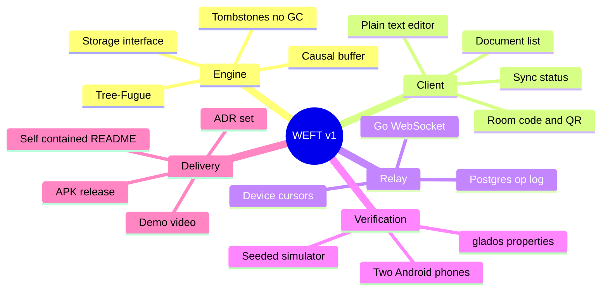

---

## 03 · Goals, non-goals & success metrics

The scope contract. Non-goals are enforced in review, not silently absorbed.

### Goals

| # | Goal | Proof |
|---|---|---|
| G1 | Hand-build Tree-Fugue and own its correctness. | Property + simulation suites pass; Fady explains tie-breaking unaided. |
| G2 | Ship a real Flutter client that is "thin on logic, rich on UX". | Two-phone offline/reconnect demo; clean architecture visible in repo. |
| G3 | Prove distributed-systems verification skill. | Published convergence numbers; reproduce-by-seed instructions. |
| G4 | Operate a production-like system on $0. | Render + Neon prod, staging on Dell, CI/CD, backup + restore drill, monitoring. |
| G5 | Create durable career evidence before service. | Public repo, demo video, APK, README, ADRs, defendability recording. |

### Non-goals (v1 — documented gaps, never silently implemented)

| Item | Reason | Disposition |
|---|---|---|
| Tombstone GC | Causal-stability GC is a second hard problem. | **OUT** — document unbounded growth as known gap. |
| Rich text / Peritext | Separate research problem. | **OUT** — plain text only. |
| List-Fugue | Performance variant, not needed for correctness. | **OUT** — stretch only. |
| E2EE / privacy layer | Key management out of runway. | **OUT** — future work; TLS in transit only. |
| User accounts / auth | Duplicates existing CV signal; protects nothing about the core. | **OUT** — room-code/QR pairing, anonymous device IDs. |
| Undo/redo | Correct concurrent undo is research-grade. | **OUT** — documented gap. |
| Live cursors / presence | Ephemeral awareness protocol = scope creep. | **OUT** — sync-status UI carries the demo. |
| Flutter web demo | Separate storage adapter. | **OUT** — two Android phones are the finish line. |
| Rust port / FFI | Owner cannot defend Rust; FFI adds memory risk. | **OUT** — post-v1 only. |
| AI features | Duplicates Valoqui signal; costs ~12% of runway. | **OUT** — stretch only if ahead. |
| Play Store | $25 fee + review latency. | **OUT** — APK via GitHub Releases. |

### Stretch (only if all core exit criteria are met early)

- List-Fugue performance comparison.
- Presence / live cursors.
- Publish `weft_core` to pub.dev.
- Tiny AI document summarization with evals.

### Success metrics

| Metric | Target | Measured by |
|---|---|---|
| Convergence | 100% across generated cases and two-phone tests. | [§13](#13--testing--verification-strategy) suites + manual script. |
| Non-interleaving | Concurrent same-position inserts remain contiguous blocks. | P-05 + demo video. |
| Verification throughput | ≥100 property cases/PR; ≥1,000 simulator seeds nightly. | CI logs. |
| Durability | Stranger can clone, run, and reproduce results without owner. | README run section + restore drill. |
| Defendability | 10-minute unaided recording answering all five gate questions. | DR-05. |

---

## 04 · Users & scenarios

Three readers of this artifact; one primary workflow.

| Persona | Need | Artifact surface |
|---|---|---|
| **Fady (builder)** | Learn CRDT correctness, Go relay ops, verification engineering; defend every merged line. | Core package, simulator, ADRs, defendability gate. |
| **Demo user (two phones)** | Create doc, pair second device, edit offline, reconnect, see identical text. | Flutter client + relay. |
| **Future reviewer (2 years later)** | Understand design, run locally, reproduce verification numbers without contacting owner. | Self-contained README, demo video, seeded tests, APK. |

### FIG 02 · Primary journey — pair, partition, converge

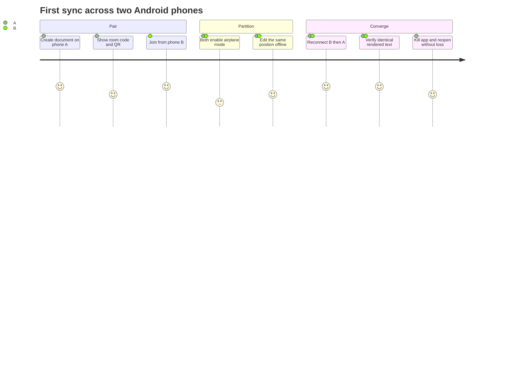

### User stories

| ID | Story | Acceptance |
|---|---|---|
| US-01 | As a user I create a document and edit it fully offline. | Airplane mode: typing, deleting, newline all work; kill/reopen preserves text. |
| US-02 | As a user I pair a second phone without an account. | Room code or QR joins the same doc; invalid code shows typed error; no login screen exists. |
| US-03 | As a user my offline edits merge when I reconnect. | Arbitrary reconnect order yields identical text on both devices; indicator reaches SYNCED. |
| US-04 | As a reviewer I reproduce a reported failure. | README lists failing seed; `dart test --name "seed-12345"` replays it deterministically. |
| US-05 | As a reviewer I verify the relay cannot corrupt documents. | Relay source contains no CRDT imports or payload interpretation; ops are opaque JSON. |

### Edge scenarios (must be covered by tests)

- Both devices insert at the same caret position while partitioned.
- Relay redelivers the same op twice; device merges idempotently.
- Delete arrives before its target insert; causal buffer holds it, never drops it.
- App killed mid-append; trailing partial log line ignored on recovery.
- Render cold start (~1 min) during first connection; client retries with backoff, shows SYNCING.
- One device reconnects after 10,000 queued ops; batching and cursor resume complete without loss.

---

## 05 · Functional requirements

P0 = required for v1. Every P0 has a testable acceptance criterion.

| ID | Requirement | Priority | Acceptance criterion |
|---|---|---|---|
| FR-01 | Plain-text editor: insert/delete at caret, multi-line, Unicode code points (Dart `runes`); no rich text. | P0 | Typing/backspace/newline render correctly; surrogate pairs never split; 10k-char doc meets NFR-01. |
| FR-02 | Document list: create, open, rename, delete with confirm + 5 s undo. | P0 | CRUD persists across restart; undo restores a deleted doc directory. |
| FR-03 | Pairing: 8-char Crockford base32 room code + QR; anonymous device UUID persisted in secure local storage. | P0 | Phone B joins phone A's doc; wrong code → typed error; no account flow anywhere. |
| FR-04 | Offline-first editing: local op appended and fsynced before UI ack. | P0 | Airplane-mode editing works; process kill loses at most the un-acked op. |
| FR-05 | Client forwards intent to core; core is the only source of rendered text and op order. | P0 | No merge/tie-break code in `apps/weft_app`; UI state derived only from `FugueDoc.render()`. |
| FR-06 | Sync status UI: OFFLINE / SYNCING / SYNCED with icon + label, pending-op count, last-synced time. | P0 | Status is never color-only; transitions match [§10](#10--sync-protocol) lifecycle; counts update live. |
| FR-07 | Reconnect resync: exchange backlog via cursor, then pending local ops; converge. | P0 | Any reconnect order satisfies CR-01 on two physical phones. |
| FR-08 | Relay store-and-forward: WS per device/doc, dedup `opId`, assign delivery `seq`, forward live, buffer durably. | P0 | Offline device receives all missed ops on reconnect; duplicate submissions create no new rows. |
| FR-09 | Cursor ack: device persists `lastSeq` after merging a batch; relay upserts cursor. | P0 | Reconnect resumes exactly after last merged batch; no gaps, no permanent duplicates. |
| FR-10 | Crash recovery: append→fsync→apply-ack; snapshot via temp file + rename; log truncation after snapshot. | P0 | Kill -9 during write leaves a recoverable store; snapshot+truncate atomic from reader's view. |
| FR-11 | APK distribution: tagged release builds APK → GitHub Releases; sideload on both phones. | P0 | `v*` tag produces an APK asset installable on both test phones. |
| FR-12 | Observability hooks: client sync events to Sentry (no document content); relay `/health` + Prometheus metrics. | P1 | Sentry receives a test error with no payload text; `/metrics` exposes devices, ops/sec, latency. |

---

## 06 · Correctness invariants

The heart of the PRD. These assertions are authored by Fady, not the agent.

> **Ownership rule.** If Fady cannot explain why an operation is correct without opening the file, he does not own it yet. The agent may draft harness scaffolding; the invariants below and the tie-breaking logic are his non-negotiably.

| ID | Invariant | Assertion | Verified by |
|---|---|---|---|
| CR-01 | Strong Eventual Consistency | Replicas receiving the same op set render identical strings, regardless of delivery order. | P-01, simulator, two-phone test. |
| CR-02 | Commutativity | `merge(A,B).render() == merge(B,A).render()` for any concurrent op sets. | P-02. |
| CR-03 | Idempotence | `merge(ops ++ ops) == merge(ops)`; duplicate delivery changes nothing. | P-03. |
| CR-04 | Causal delivery | Ops with unknown `leftOrigin` or delete target are buffered, never dropped; applied when dependencies arrive. | P-04. |
| CR-05 | Maximal non-interleaving | Concurrent same-position inserts from two replicas remain contiguous blocks, ordered deterministically by NodeID. | P-05 + demo. |
| CR-06 | Tombstone integrity | Deleted nodes remain referenceable as origins; delete is idempotent; no GC in v1. | P-06. |

### Fugue model (v1 choices)

- **Tree-Fugue first.** List-Fugue is stretch. Every inserted code point is a node; deletions mark tombstones.
- **NodeID:** `{ r: replicaUUID, c: monotonicCounter }`. Virtual root `{ r:"root", c:0 }` anchors the first insert.
- **Left origin:** insert records the node it follows; concurrent same-origin inserts are tie-broken by NodeID order (replica UUID, then counter).
- **Causal buffer:** hold ops whose dependencies are unknown; retry after each merge. Never apply out of causal order.
- **Rendering:** deterministic tree traversal skipping tombstones; traversal order is part of the spec, not an implementation detail.

> **Checkpoint · 2026-12-09.** If the core is not passing randomized convergence property tests by end of week 4, fall back to RGA, document the interleaving anomaly it exhibits, and list Fugue as future work. Decide on test results, not feelings. The fallback still ships a correct, tested, offline-first sync engine.

---

## 07 · Non-functional requirements

Budgets are targets measured on mid-range hardware and free-tier infra; misses are recorded, not hidden.

| ID | Attribute | Budget / constraint | Measurement |
|---|---|---|---|
| NFR-01 | Edit latency | ≤16 ms render for ≤10k chars on Snapdragon-680-class device. | Flutter profile trace on phone A. |
| NFR-02 | Merge throughput | ≤50 ms to merge 100 remote ops into a 10k-char doc. | Dart benchmark test in CI. |
| NFR-03 | Cold start | ≤2 s app launch → editable document. | Manual timing, release build. |
| NFR-04 | Offline queue | ≥10,000 persisted ops without loss. | Simulator + device test. |
| NFR-05 | Relay latency | p95 forward ≤250 ms at 20 concurrent devices/doc on Render free. | Go load smoke with bot clients. |
| NFR-06 | CI verification | 100 property cases/property on PR ≤30 s; 1,000 simulator seeds nightly ≤60 s. | GitHub Actions timing. |
| NFR-07 | Compatibility | Android 8.0+ (API 26), Flutter stable, APK ≤40 MB. | Both physical test phones. |
| NFR-08 | Cost | $0/month; stay inside every free-tier quota in [§14](#14--operations--cicd). | Quota dashboard + alerts at 80%. |
| NFR-09 | Privacy | No accounts, no PII; room code is a bearer secret (documented limitation); TLS in transit; no E2EE v1; never log document payloads. | Code review + Sentry payload scrubbing. |
| NFR-10 | Accessibility | Sync status icon+label; AA contrast; font scaling to 1.3× without clipping. | Manual check at 1.3× scale. |

---

## 08 · System architecture

Three components, three jobs. None does another's work.

### FIG 03 · System architecture — correctness lives only in the core

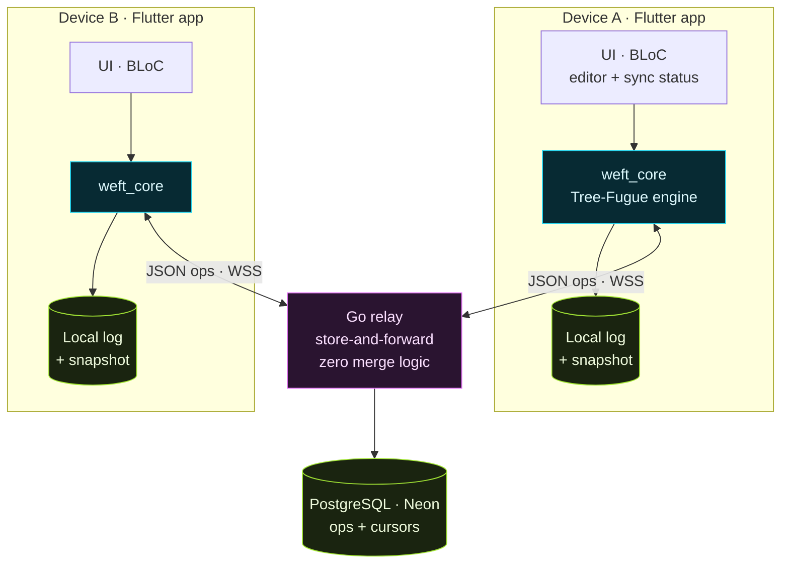

| Component | Owns | Forbidden |
|---|---|---|
| `packages/weft_core` (pure Dart) | All merge order, tie-breaking, causal buffering, convergence, serialization, Storage interface. | Flutter imports; network calls; UI state. |
| `apps/weft_app` (Flutter) | Rendering, intent capture, persistence wiring, sync status, pairing UX. | Any merge/conflict/ordering logic. |
| `relay/` (Go) | WS lifecycle, dedup, seq assignment, durable buffering, cursor resume, metrics. | Parsing or validating CRDT semantics; interpreting payload beyond opaque JSON storage. |

> **Containment argument (interview-defensible).** The relay is intentionally dumb. A relay bug can delay or duplicate delivery, but it cannot corrupt a document because the core's merge is commutative and idempotent. Blast radius is contained by design, not by hope.

### Repository layout

```text
weft/
├── packages/weft_core/        # pure Dart: engine, storage interface, properties, simulator
│   ├── lib/
│   ├── test/                  # unit + glados properties + seeded simulator
│   └── pubspec.yaml
├── apps/weft_app/             # Flutter client: BLoC, fpdart, get_it, auto_route
├── relay/                     # Go: coder/websocket, Postgres, Dockerfile
├── docs/adr/                  # ADR-0001 … (see §17)
├── docs/devlog/               # weekly devlog NN.md
├── docker/                    # compose.staging.yml, postgres init
├── .github/workflows/         # ci.yml, release.yml, nightly.yml, backup.yml
├── AGENTS.md                  # agent operating contract (§19)
├── PRD.md                     # this document
└── README.md                  # self-contained reviewer entry point
```

---

## 09 · Core data model & persistence

Append-only log + snapshot behind a Storage interface. No SQL in the core.

### FIG 04 · Core types and storage boundary

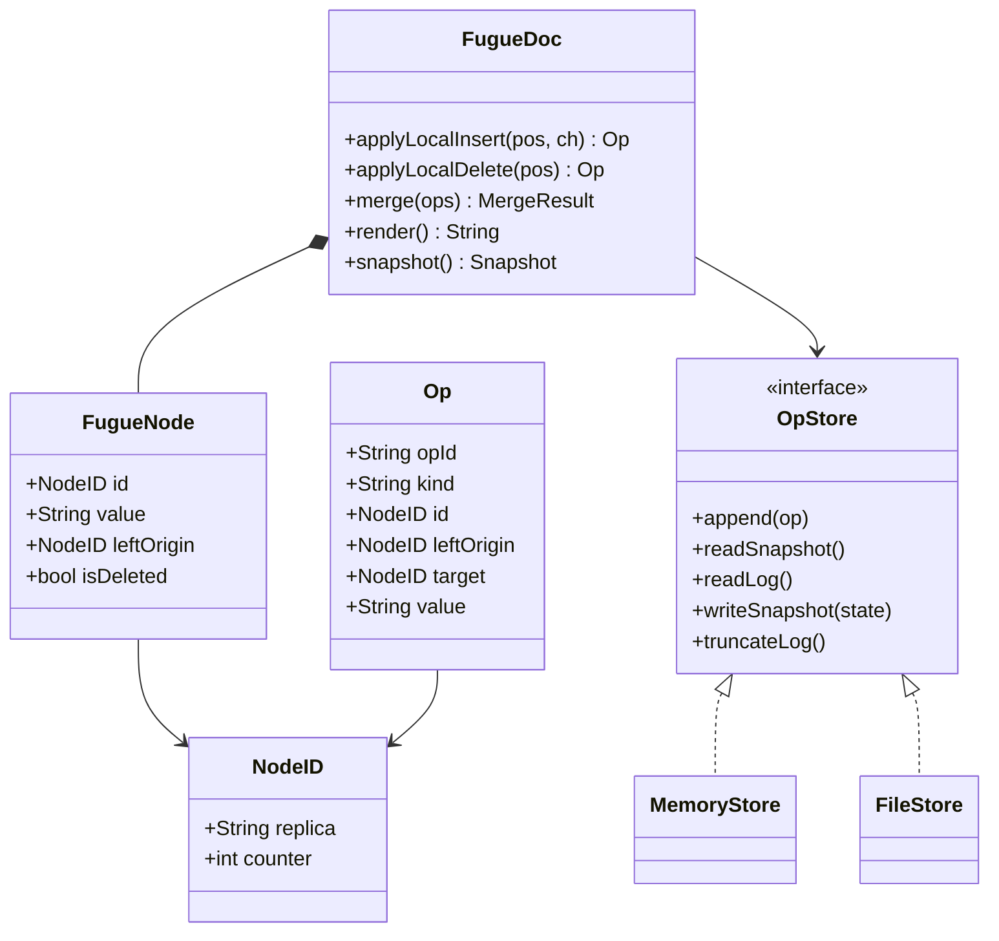

### Operation schema (JSON, v1)

**Insert**

```json
{
  "v": 1,
  "opId": "3f2a…:42",
  "kind": "ins",
  "id":    { "r": "3f2a…", "c": 42 },
  "left":  { "r": "9b1c…", "c": 17 },
  "value": "a"
}
```

**Delete**

```json
{
  "v": 1,
  "opId": "3f2a…:43",
  "kind": "del",
  "target": { "r": "9b1c…", "c": 17 }
}
```

- `opId` is opaque to the relay and unique per operation. For inserts, `id` equals the op's NodeID; for deletes, `opId` uses the replica's next counter and `target` references the node.
- `left` may be the virtual root `{"r":"root","c":0}`. `value` is exactly one Unicode code point.
- Unknown schema version → typed protocol error; never guess.

### Local store layout (per document)

```text
<appDocs>/weft/<docId>/
├── manifest.json     # {docId,title,createdAt,snapshotVersion,lastSeq}
├── snapshot.json     # full serialized tree + tombstones + replica counters
├── ops.log           # one JSON op per line, appended after snapshot
└── snapshot.tmp      # transient during atomic snapshot write
```

### Storage contract

```dart
abstract interface class OpStore {
  Future<void> append(Op op);             // append line + fsync BEFORE ack
  Future<Snapshot?> readSnapshot();
  Future<List<Op>> readLog();             // ignore trailing partial line
  Future<void> writeSnapshot(Snapshot s); // tmp → fsync → rename
  Future<void> truncateLog();             // only after snapshot rename
}
```

- **Recovery order:** read manifest → read snapshot → replay log → verify counters → render. Trailing partial line is discarded, not parsed.
- **Snapshot policy:** every 500 ops or 30 s of idle, whichever first; snapshot+truncate is atomic from the reader's perspective.
- **Purity:** `MemoryStore` for tests; `FileStore` uses `dart:io` only. No `sqflite`, no ObjectBox, no Flutter imports in the core.
- **Known gap:** tombstones accumulate forever in v1; document growth cost in README.

---

## 10 · Sync protocol

At-least-once delivery + idempotent merge. JSON ops in v1; binary encoding is stretch.

### Messages

| Type | Direction | Payload | Rule |
|---|---|---|---|
| `hello` | device → relay | `{docId, deviceId, roomCode, lastSeq}` | Relay verifies room-code hash; creates doc row if absent and code supplied. |
| `ops` (backlog) | relay → device | `{seqMax, ops:[Op]}` | Batches ≤256 ops / 256 KB; device merges then acks cursor. |
| `ops` (local) | device → relay | `{ops:[Op]}` | Relay dedups by `opId`, assigns `seq`, forwards to other live devices, acks sender. |
| `ack` | relay → device | `{opIds, seqMax}` | Sender marks pending ops sent; core already applied them locally. |
| `cursor` | device → relay | `{lastSeq}` | Sent only after batch is merged and persisted; relay upserts `cursors`. |
| `error` | relay → device | `{code, message}` | Typed codes: `bad_code`, `bad_schema`, `rate_limited`, `too_large`. |
| `ping/pong` | both | `{}` | 30 s interval; missed pong → reconnect with backoff. |

### FIG 05 · Local edit, end to end

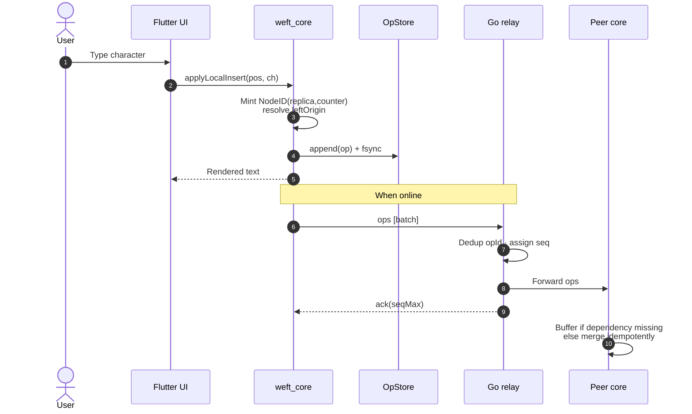

### FIG 06 · Reconnect — cursor resume, then pending exchange

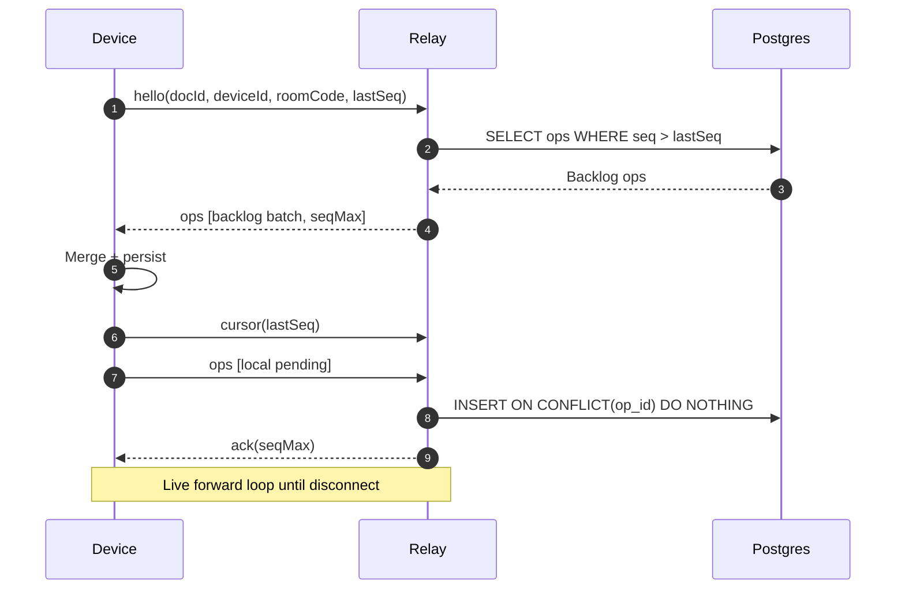

### FIG 07 · Connection lifecycle

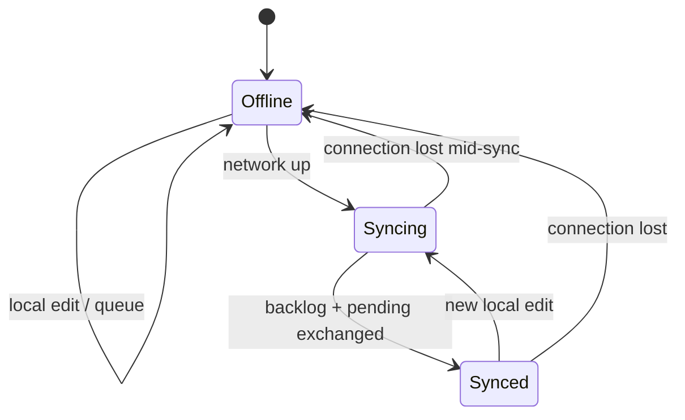

### Delivery guarantees

- **At-least-once:** relay may redeliver; core idempotence (CR-03) makes duplicates harmless.
- **Causal safety:** relay does not order by dependency; core buffers unknown origins/targets (CR-04).
- **Backpressure:** pause socket reads when write buffer is high; resume on drain. Max frame 1 MB; max batch 256 ops / 256 KB.
- **Reconnect backoff:** 1 s → 2 s → 4 s → 8 s → 15 s cap, jittered. Cold-start wake handled transparently.

---

## 11 · Relay & database

Go + `coder/websocket` + Neon Postgres. The relay stores opaque blobs and cursors — nothing smarter.

### FIG 08 · Relay schema

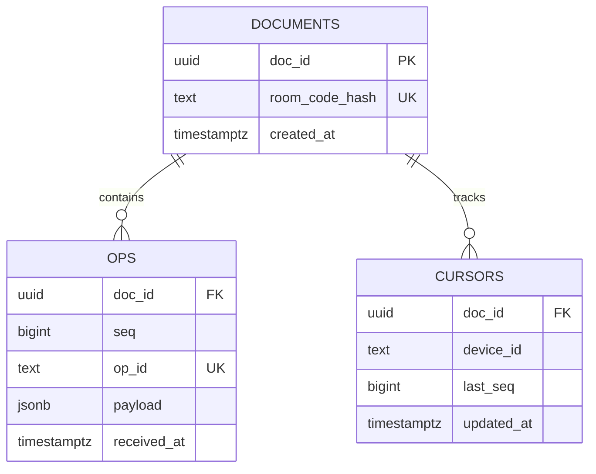

### Migration 001

```sql
CREATE TABLE documents (
  doc_id         UUID PRIMARY KEY,
  room_code_hash TEXT UNIQUE NOT NULL,
  created_at     TIMESTAMPTZ NOT NULL DEFAULT now()
);
CREATE TABLE ops (
  doc_id      UUID NOT NULL REFERENCES documents(doc_id) ON DELETE CASCADE,
  seq         BIGINT NOT NULL,
  op_id       TEXT NOT NULL UNIQUE,
  payload     JSONB NOT NULL,
  received_at TIMESTAMPTZ NOT NULL DEFAULT now(),
  PRIMARY KEY (doc_id, seq)
);
CREATE TABLE cursors (
  doc_id     UUID NOT NULL REFERENCES documents(doc_id) ON DELETE CASCADE,
  device_id  TEXT NOT NULL,
  last_seq   BIGINT NOT NULL DEFAULT 0,
  updated_at TIMESTAMPTZ NOT NULL DEFAULT now(),
  PRIMARY KEY (doc_id, device_id)
);
CREATE INDEX ops_doc_seq_idx ON ops(doc_id, seq);
```

### Endpoints

| Endpoint | Purpose | Notes |
|---|---|---|
| `GET /health` | Liveness + version | Returns `{status, version, uptime}`; used by UptimeRobot keep-alive. |
| `GET /join/{roomCode}` | Resolve code → docId | Hash input, lookup `room_code_hash`; 404 on unknown. |
| `WS /ws` | Op transport | `hello` handshake per [§10](#10--sync-protocol); TLS terminated by Render. |
| `GET /metrics` | Prometheus text | Connected devices, ops in/out, forward latency histogram, dedup hits. |

- **Seq assignment:** one transaction per batch; lock document row `FOR UPDATE`, compute `max(seq)+1`, insert with `ON CONFLICT(op_id) DO NOTHING`; return existing seq for duplicates.
- **Room codes:** 8-char Crockford base32 generated client-side; relay stores SHA-256 hash only. QR encodes `weft://join?doc=<uuid>&code=<code>`. Code is a bearer secret — anyone holding it can join (documented limitation).
- **Logging:** metadata only (docId, deviceId, seq, opId, latency). Never log `payload` or rendered text.
- **Config:** `DATABASE_URL`, `PORT`, `LOG_LEVEL`, `MAX_BATCH_OPS=256`, `MAX_FRAME_BYTES=1048576`. Migrations via embedded SQL + `goose`.

---

## 12 · Client UX specification

Thin on logic, rich on UX. The client renders core state and forwards intent — nothing else.

| Screen | Elements | Behavior |
|---|---|---|
| Document list | Title, last edited, sync badge, create FAB, overflow menu. | Create/rename/delete with confirm + undo; empty state explains offline-first value. |
| Editor | Plain-text field, caret, sync indicator, pending count, doc title. | All edits go through core; text never set directly from network payload. |
| Pairing | Room code + QR (host); code entry + camera scan (join). | Invalid code → typed error + retry; success navigates to editor in SYNCING. |
| Settings / About | Device ID, relay URL (staging/prod), version, licenses, known gaps. | Relay URL switch requires reconnect; no account UI exists. |

### Sync indicator states

| State | Icon + label | Trigger |
|---|---|---|
| OFFLINE | ⦸ OFFLINE · amber | No socket; local edits queue. |
| SYNCING | ⟳ SYNCING · cyan | Connecting, exchanging backlog/pending, or cold-start retry. |
| SYNCED | ✓ SYNCED · green | Backlog merged, pending acked, cursor persisted. |
| ERROR | ⚠ RETRYING · red | Typed protocol error or repeated failure; backoff visible. |

### Client architecture

- **Presentation:** BLoC/Cubit + freezed states; widgets render, never decide.
- **Domain:** use-cases wrap `FugueDoc` facade; fpdart `Either` for typed failures.
- **Data:** core adapter, `FileStore` path wiring, WebSocket sync service, secure storage for device UUID.
- **DI:** get_it per-feature modules; repository vs datasource lifecycles explicit (lesson from Valoqui dead-singleton crash).
- **Navigation:** auto_route; deep link `weft://join` handled on cold and warm start.

> **Hard boundary.** Any PR that puts merge order, tie-breaking, or conflict resolution in the Flutter layer is rejected. The client's only text source is `FugueDoc.render()`.

---

## 13 · Testing & verification strategy

Manual review will not catch concurrent-correctness bugs. Properties + simulation are load-bearing infrastructure.

| Layer | Tool | Scope | Gate |
|---|---|---|---|
| L1 Unit | `dart test`, `go test` | Core: public API only (`FugueDoc`, `OpStore`). Relay: black-box WS/HTTP + DB rows. App: bloc + domain/data. **No widget tests.** | Every PR |
| L2 Property | `glados` | Random op sequences across replicas; assert CR-01…CR-06. | 100 cases/property per PR; 500 nightly. |
| L3 Simulation | Hand-built seeded scheduler | Delay/drop/dup/reorder/partition; eventual delivery; convergence. | 100 seeds per PR; 1,000 nightly. |
| L4 Manual | Two physical Android phones | Airplane-mode partition, arbitrary reconnect order, kill/reopen. Recorded in `docs/e2e.md`. | M3 exit + demo video |

### Property catalog

Assertions use `package:checks`. Properties target the public API only, so swapping the engine implementation requires no test edits — demonstrated at M2 when the stub is replaced.

| ID | Property | Generator | Shrink target |
|---|---|---|---|
| P-01 | Convergence (CR-01) | N replicas, random inserts/deletes, shuffled delivery. | Minimal op set + delivery order that diverges. |
| P-02 | Commutativity (CR-02) | Two concurrent op batches applied in both orders. | Smallest non-commuting pair. |
| P-03 | Idempotence (CR-03) | Op list duplicated 1–3×. | Single op whose reapplication changes state. |
| P-04 | Causal buffering (CR-04) | Deliver delete before insert; insert before origin. | Earliest missing dependency. |
| P-05 | Non-interleaving (CR-05) | Two replicas type runs at the same origin. | Shortest interleaved output. |
| P-06 | Tombstone integrity (CR-06) | Delete then insert referencing deleted origin. | Broken origin reference. |

### Deterministic simulator spec

```json
{
  "seed": 12345,
  "replicas": 3,
  "opsPerReplica": 200,
  "faults": { "delay": 0.2, "drop": 0.05, "dup": 0.05, "reorder": 0.2, "partition": 0.1 },
  "eventualDelivery": true,
  "assert": ["convergence", "nonInterleaving", "causalSafety"]
}
```

- Single-threaded, seeded PRNG; no wall-clock, no real sockets. Every failure prints the seed and a minimized op trace.
- "Drop" means delayed retransmission, not permanent loss — `eventualDelivery:true` must deliver every unique op eventually.
- Simulator is hand-built (no library). It is the second signature skill alongside the CRDT.

### Sabotage suite (replaces coverage as the quality gate)

Eight deliberately wrong merge variants live in `scripts/sabotage.manifest`. Each maps to an invariant. `just sabotage` applies one variant at a time and runs the property + simulator suite; the suite **must fail**. A surviving mutant means the tests are too weak and fails the build. A `sed` that matches nothing is reported `BROKEN` and also fails — the manifest cannot go stale silently.

| Mutant | Invariant |
|---|---|
| reverse-tiebreak | CR-05 |
| no-causal-buffer | CR-04 |
| non-idempotent-apply | CR-03 |
| physical-tombstone-delete | CR-06 |
| index-instead-of-nodeid | CR-01 |
| ignore-left-origin | CR-05 |
| drop-opid-dedup | CR-03 |
| swap-traversal-order | CR-01 |

All entries are armed during M1. From M1 exit, nightly runs `just sabotage --strict`.

### Coverage

Coverage is a hygiene ratchet, not a headline gate: `weft_core` coverage may never fall below the baseline locked at end of M1. Coverage measures lines executed, not assertions made, and is a weak correctness signal for a CRDT. The sabotage suite is the real gate.

### Benchmarks

Absolute NFR budgets are verified locally on the Dell under fixed conditions (plugged in, same governor, warmup). CI benchmark numbers are informational. Nightly local runs append to `docs/BENCHMARKS.md`; a ticket opens only after **two consecutive** regressions >10% against the median of the last five runs.

### Traceability

| Requirement | Verification |
|---|---|
| CR-01…CR-06 | P-01…P-06 + simulator + two-phone script. |
| FR-04 / FR-10 | Storage crash-recovery unit tests + kill/reopen device test. |
| FR-08 / FR-09 | Relay integration tests: dedup, cursor resume, offline buffering. |
| NFR-01 / NFR-02 | Dart benchmarks in CI; Flutter profile trace on phone. |
| NFR-05 | Go bot load smoke: 20 devices, p95 forward latency. |
| NFR-09 | Sentry scrubbing test; relay log review (no payload). |

---

## 14 · Operations & CI/CD

T1.5 on $0: staging/prod split, CI/CD, backups with a real restore drill, monitoring, published numbers.

| ID | Requirement | Acceptance |
|---|---|---|
| OR-01 | Prod = Render free + Neon free; Dell = dev/staging only. No always-on home server. | Public HTTPS URL serves relay; staging Compose runs locally on demand. |
| OR-02 | CI required checks block merge. | Red PR cannot merge; checks cover Dart core, relay, app. |
| OR-03 | CD via Render deploy hook on main + migrations + post-deploy smoke. | Merge to main deploys and passes `/health` + WS echo smoke. |
| OR-04 | Nightly: full property + simulator run, encrypted backup. | Scheduled workflow green; backup artifact lands in Drive. |
| OR-05 | One real restore drill into staging during M4. | Row counts verified, cursor resume works, two-phone sync against staging; recorded in ADR. |
| OR-06 | Monitoring: Grafana Cloud + Sentry + UptimeRobot. | Dashboard live, test error received, uptime monitor pinging every 5 min. |
| OR-07 | Cold-start honesty: `/health` returns version; README documents ~1 min wake. | Client retries transparently; caveat visible in README. |
| OR-08 | Budget guards at 80% of measurable free-tier quotas. | Alert fires before quota exhaustion; response per [§16](#16--risks--tripwires). |

### Topology & free-tier constraints

| Layer | Choice | Constraint / note |
|---|---|---|
| Prod compute | Render free web service (Docker) | 750 instance-h/mo, 0.1 CPU / 512 MB; spins down after 15 min idle; ~1 min cold start. UptimeRobot 5-min ping keeps it warm within quota. |
| Prod DB | Neon free Postgres | 0.5 GB, 100 CU-h/mo, autosuspend 5 min. Not Render Postgres (30-day expiry). |
| Staging | Docker Compose on Dell | Runs only while developing. i7-11800H / 16 threads / 14 GB RAM / 207 GB free. |
| CI | GitHub Actions (public repo) | Free hosted runners; required checks block merge. |
| CD | Render deploy hook on main | No always-on home server; no self-hosted runner required for deploy. |
| Monitoring | Grafana Cloud free + Sentry dev + UptimeRobot | 10k series / 50 GB logs / 14-day retention; 5k errors/mo; 5-min ping doubles as keep-alive. |
| Backups | `pg_dump` → age encrypt → rclone → Google Drive | Nightly cron; one real restore drill in M4. |
| Distribution | APK via GitHub Releases | Tag `v*` triggers build. No Play Store. |
| Local gates | lefthook | pre-commit (<10 s): format, analyze, secret scan · commit-msg: Conventional Commits · pre-push: `just ci` |
| Command entry point | just | Every gate is `just <recipe>`; local and CI cannot drift |
| Drift gate | `just drift` | STACK vs manifests · doc recipes vs justfile · allowlisted skills on disk · ADR references · requirement IDs |
| Container image | `gcr.io/distroless/static-debian12` | No shell in the relay image |

### FIG 09 · CI/CD pipeline

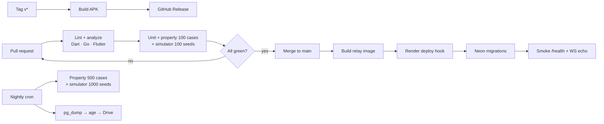

### `.github/workflows/ci.yml` — skeleton

```yaml
name: ci
on: { pull_request: {}, push: { branches: [main] } }
jobs:
  core:
    runs-on: ubuntu-latest
    steps:
      - uses: actions/checkout@v4
      - uses: dart-lang/setup-dart@v1
      - run: dart pub get
        working-directory: packages/weft_core
      - run: dart format --set-exit-if-changed .
        working-directory: packages/weft_core
      - run: dart analyze --fatal-infos
        working-directory: packages/weft_core
      - run: dart test --coverage
        working-directory: packages/weft_core
  relay:
    runs-on: ubuntu-latest
    steps:
      - uses: actions/checkout@v4
      - uses: actions/setup-go@v5
        with: { go-version: stable }
      - run: go vet ./...
        working-directory: relay
      - run: go test ./... -race
        working-directory: relay
  app:
    runs-on: ubuntu-latest
    steps:
      - uses: actions/checkout@v4
      - uses: subosito/flutter-action@v2
        with: { channel: stable }
      - run: flutter analyze
        working-directory: apps/weft_app
      - run: flutter test
        working-directory: apps/weft_app
```

### Backup & restore

```bash
# backup (nightly)
pg_dump "$DATABASE_URL" -Fc -f backup.dump
age -r "$AGE_RECIPIENT" -o backup.dump.age backup.dump
rclone copy backup.dump.age gdrive:weft-backups/

# restore drill (M4, into staging only)
age -d -i key.txt backup.dump.age > backup.dump
pg_restore --clean --if-exists -d "$STAGING_DATABASE_URL" backup.dump
# verify: row counts, cursor resume, two-phone sync against staging
```

> **Free-tier honesty.** Cold starts, quota ceilings, and best-effort uptime are documented in the README as design constraints, not hidden. The recorded demo and repo are the durable evidence; the live URL is a bonus that may lapse during service.

---

## 15 · Schedule & milestones

Walking skeleton first. The unfamiliar integration/ops risk is retired before the hard algorithm work.

### FIG 10 · 8 build weeks + polish

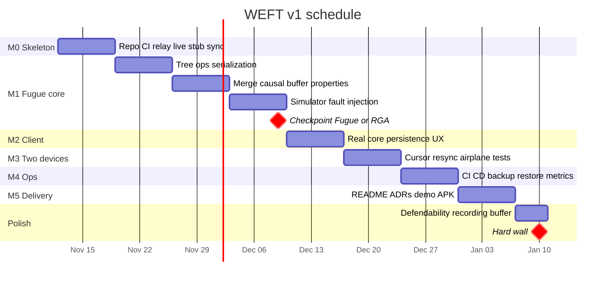

| # | Dates | Milestone | Exit criteria |
|---|---|---|---|
| M0 | Nov 13–20 | Walking skeleton | Public repo + CI green; relay live on Render/Neon with public URL; two phones exchange **stub** ops; property harness runs against stub; Android build meets AGP ≥8.12.1, Gradle ≥8.13, Java 17. |
| M1 | Nov 19–Dec 9 | Fugue core correct | Wk2 tree/NodeID/insert/leftOrigin/tombstone/serialization; Wk3 merge/causal buffer/tie-break/idempotence; Wk4 simulator. Hundreds of generated cases converge. **Checkpoint Dec 9.** |
| M2 | Dec 10–16 | Real client + persistence | Stub swapped for Fugue behind same interface; file log + snapshot + crash recovery; doc list, pairing, sync UI; kill/reopen loses nothing. |
| M3 | Dec 17–23 | Two-device sync | Cursor resync on reconnect; two physical phones, airplane mode, arbitrary reconnect order → always converge. |
| M4 | Dec 24–30 | Ops + numbers | Staging/prod split; CD via deploy hook; backup **and restore drill done**; monitoring live; simulation numbers published. |
| M5 | Dec 31–Jan 6 | Delivery | Self-contained README; ADRs complete; demo video recorded; APK on GitHub Releases. |
| P | Jan 7–10 | The gate | 10-minute unaided recording; CV updated (git-rs honest framing); case-study devlog; slippage buffer. |

> **Toolchain note.** The full toolchain upgrade (Q60) precedes repo creation and consumes 1–2 h. M0 therefore targets Nov 19 with buffer to Nov 20. The hard wall of 2027-01-10 is unchanged; the buffer absorbs the slip.

### FIG 11 · Build-hour allocation (~280 h)

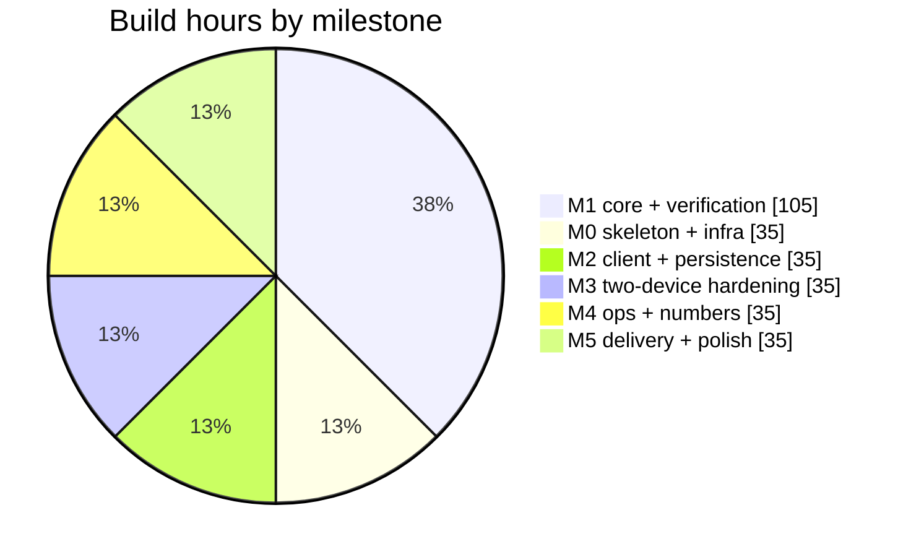

### Cut order under pressure (first to die → last)

1. Stretch items (already out).
2. Multi-document support → one shared document.
3. Flutter polish → bare but clean editor.
4. Demo-video production quality → raw screen recording is fine.
5. Ops extras → drop elaborate dashboards/load numbers; keep CI/CD + backups + uptime.

> **Never cut.** Property-based convergence tests · deterministic simulator · README design-decisions section · two-phone convergence demo. Those four **are** the project.

---

## 16 · Risks & tripwires

Each risk has a trigger and a pre-decided response. No mid-project renegotiation.

| Risk | Trigger | Pre-decided response |
|---|---|---|
| Fugue correctness slips | Dec 9 checkpoint: randomized convergence properties failing. | RGA fallback; document interleaving anomaly; Fugue as future work. Still ships a tested sync engine. |
| Agent-generated merge bugs | Any convergence failure under property/sim tests. | Fady diagnoses from minimized seed; agent may propose hypotheses, never owns the fix rationale. |
| Free-tier limits | Render hours >80%, Neon CU-h >80%, frequent cold starts. | Reduce ping frequency, batch ops, document constraints; recorded demo is the durable artifact. |
| January wall | Any milestone >3 days behind. | Apply [§15](#15--schedule--milestones) cut order immediately; never cut the protected four. |
| Scope creep | PR touches a non-goal. | Reject PR; add to future-work list instead. |
| Device/network flakiness | Two-phone test fails but sim passes. | Reproduce in simulator with matching fault profile first; fix environment, not the CRDT, unless properties also fail. |
| Burnout | >40 h/week or two missed devlogs. | Hold 35+5 split; cut scope, not sleep. |
| Deployment lapse during service | Live URL down after Jan 10. | Acceptable. Repo + video + README + APK remain the evidence; README explains self-hosting. |
| Cannot defend the result | Weekly 5-line gate fails or final recording incomplete. | Not done. Re-study the failing area; the recording is the finish line, not the code. |

---

## 17 · Process & AI delegation

Team-grade process, solo builder. The process artifacts are part of the portfolio.

### FIG 12 · Branch / PR flow

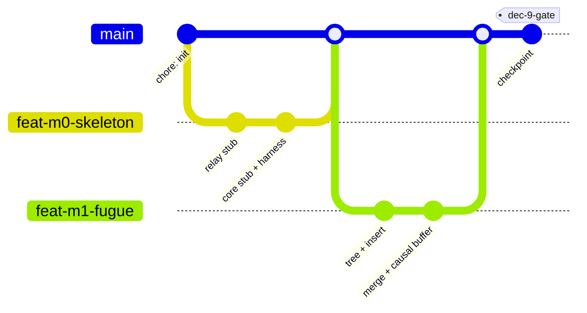

| ID | Rule |
|---|---|
| PR-01 | Public monorepo `weft`, MIT, from commit #1. Conventional commits; pre-commit hooks run format + analyze. |
| PR-02 | Branch per card; PR + self-review; CI required checks block merge. WIP ≤2 on the issues board (Backlog → In Progress → Review → Done). |
| PR-03 | **Defendability gate:** every PR touching `packages/weft_core` carries five lines written by Fady, in his own words, no file open — what changed, why it is correct, which invariant it protects, which test proves it, what could still break. The agent prompts for this text and must never write it. |
| PR-04 | ADR for every major decision (list below). |
| PR-05 | Weekly devlog (5 h/week): LinkedIn post + `docs/devlog/NN.md`. Doubles as marketing and the explain-it-back ritual. |
| PR-06 | Skill routing per `opencode.jsonc`: default-deny, explicit allow/ask tiers. Conflicting skills are denied, not deleted. spec-kit, Artemis and EGM are forbidden in this repo. |
| PR-07 | git-rs stays public; defend git internals + interop oracle; state plainly it was agent-assisted; no Rust proficiency claim on CV. |
| PR-08 | No formal job applications during build (military certificate blocks employment). Artifact converts when status resolves. |
| PR-09 | Test-strength gate: the sabotage suite must kill every armed mutant. Coverage is a ratchet only. |
| PR-10 | Model-agnostic config: no `model` key in repo config. Capability floor in `AGENTS.md`; each core PR records the model used. |
| PR-11 | Dependency policy: `STACK.md` is the contract. Listed optional packages need a STACK update; anything unlisted needs an ADR. |

### Planned ADRs

| ADR | Decision |
|---|---|
| 0001 | Pure Dart core, not Rust + FFI |
| 0002 | Tree-Fugue first, List-Fugue stretch |
| 0003 | Dumb relay + containment argument |
| 0004 | Append-only log + snapshot persistence |
| 0005 | Room-code/QR pairing, no accounts |
| 0006 | Cursor-based delivery protocol |
| 0007 | Hand-built deterministic simulator |
| 0008 | Free-tier ops topology |
| 0009 | Cut order + Dec 9 checkpoint |
| 0010 | RGA fallback (only if triggered) |
| 0011 | Restore drill result (M4 evidence) |

### FIG 13 · Delegation map — correctness risk vs novelty

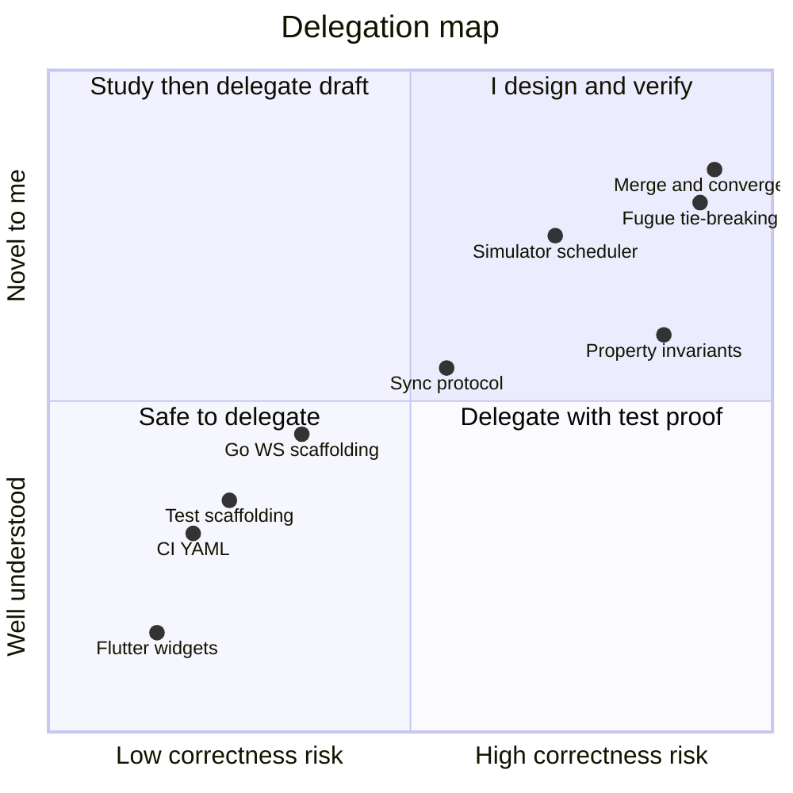

**Safe to delegate (review lightly)**
- Flutter widgets, layout, sync-status UI.
- Go WS scaffolding, routes, Dockerfile.
- CI YAML, test-file structure, doc formatting.

**Must be Fady's (non-negotiable)**
- Definition of "correct" — the invariants themselves, authored before any property test.
- Tie-breaking logic in the merge algorithm.
- Diagnosing any convergence failure.
- README design-decisions section, own words.
- The five-line PR gate and final recording.

---

## 18 · Deliverables & definition of done

The recording is the real finish line. Code that cannot be defended is not done.

| ID | Deliverable | Acceptance |
|---|---|---|
| DR-01 | Two-phone demo video | Script below, recorded on both physical Android phones: partition → divergent edits → reconnect → contiguous convergence → kill/reopen persistence. |
| DR-02 | Self-contained README | Skeleton below; a stranger in two years can clone, run, and reproduce verification without the owner. |
| DR-03 | Published verification numbers | Property case counts, simulator seed counts, convergence rate, p95 forward latency; reproduce-by-seed instructions. |
| DR-04 | APK on GitHub Releases | Tagged build installable on both test phones. |
| DR-05 | Defendability recording | 10 minutes, unaided, answering all five gate questions. Linked from README. |
| DR-06 | ADR set + superseded-foundation note | All planned ADRs written; foundation doc marked superseded with deltas. |

### Required documents

`README.md`, `PRD.md`, `AGENTS.md`, `STACK.md`, `GLOSSARY.md`, `docs/CODING-STANDARDS.md`, `docs/TESTING.md`, `docs/RUNNING.md`, `docs/BENCHMARKS.md`, `docs/SECURITY.md`, `docs/e2e.md`, `docs/adr/README.md`, `docs/adr/`, `docs/devlog/`, `CHANGELOG.md`.

### Definition of done

- [ ] Two physical devices converge after arbitrary offline periods, in either reconnect order.
- [ ] Property tests pass for convergence under randomized interleaving (hundreds of cases).
- [ ] Simulator passes under delay, duplication, reordering, and partition.
- [ ] No interleaving anomalies when two devices type concurrently at the same position.
- [ ] Tombstone growth documented as a known v1 gap (GC explicitly out).
- [ ] README documents engineering decisions in Fady's own words, not just usage.
- [ ] Demo video exists; APK released; live URL documented with cold-start caveat.
- [ ] Restore drill completed and recorded in an ADR.
- [ ] CI green on main; nightly verification running.
- [ ] `just drift` green — docs and code agree mechanically.
- [ ] Sabotage suite armed with all eight mutants; every one killed.
- [ ] `opencode.jsonc` committed; skill allowlist matches vendored skills on disk.
- [ ] 10-minute unaided defendability recording complete — **this is the real finish line.**

### Demo video script

1. Two phones side by side, same document, both online, SYNCED badges visible.
2. Both enable airplane mode → OFFLINE badges.
3. Phone A types at position X; phone B types at the *same* position → show divergent local text.
4. Reconnect B first, then A → both converge; text blocks contiguous, not character-shuffled.
5. Kill app on A, reopen → content persists.
6. Cut to simulator output: seed, fault profile, convergence rate, test counts.

### README skeleton

1. Pitch + demo video + APK + live URL (cold-start caveat).
2. Architecture diagram + why the relay is dumb (containment argument).
3. Why Fugue: interleaving anomaly with a concrete example.
4. Design decisions in own words, linked to ADRs.
5. Correctness: properties asserted, simulator design, published numbers, reproduce-by-seed.
6. Known v1 gaps (GC, undo, presence, rich text, E2EE, accounts, web).
7. How to run: core tests, relay via Compose, Flutter app, two-phone demo.
8. Ops: free-tier constraints, staging/prod, backup/restore.
9. What I owned vs delegated (honest agent split).
10. Future work: Rust port, List-Fugue, GC, E2EE, accounts.

### Defendability gate — five questions

1. Walk me through two devices editing the same position offline, then reconnecting — trace the origin-based tie-breaking.
2. What happens if the relay redelivers the same operation twice?
3. How do you know the merge logic is correct, not just correct on the cases you tried?
4. Why Fugue and not a simpler CRDT like RGA?
5. Why is the relay dumb, and what does that containment buy you?

---

## 19 · Agent operating contract

Mirror this section into `AGENTS.md` verbatim. This PRD is the single source of truth; the foundation doc is partially superseded.

### Superseded deltas (foundation v1.0 → this PRD)

| Foundation says | PRD says |
|---|---|
| Rust core + `flutter_rust_bridge` FFI | **Pure Dart core.** No FFI. Rust post-v1 only. |
| ~6 months, July → January | **~8 weeks, Nov 12 → Jan 10.** July start never happened. |
| Tombstone GC in Definition of Done | **Cut.** Documented v1 gap. |
| "Self-taught Rust, built git-rs from scratch" | Agent-assisted; cannot defend Rust. No proficiency claim. |
| "Mobile & Systems Engineer" identity | **Flutter-first**, engine as differentiator. |
| Relay queue unspecified | **Postgres op-log + per-device cursors** ([§11](#11--relay--database)). |
| Core-first phase order | Walking skeleton first (M0), stub engine satisfies CR-01/02/03; P-04/05/06 skipped until M1. |
| Interviews as immediate target | **Durable artifact; conversion deferred** until military status resolves. |

### Operating rules

1. This PRD is authoritative. If a task conflicts with it, stop and ask Fady; do not infer.
2. Never implement a non-goal ([§03](#03-goals-non-goals--success-metrics)). If it seems needed, propose an ADR instead of coding it.
3. Test-first for the core: write the property before the merge logic it constrains. Agent drafts harness structure; Fady authors invariants.
4. Every core PR must include Fady's five-line own-words gate (PR-03). The agent prompts for it and must not write it.
5. Run local gates before opening a PR: `dart format`, `dart analyze --fatal-infos`, `dart test`, `go vet`, `go test -race`, `flutter analyze`, `flutter test`.
6. Keep `weft_core` pure: no Flutter imports, no network, no UI. Keep the relay payload-opaque. Keep merge logic out of the client.
7. JSON ops schema v1 only ([§09](#09--core-data-model--persistence)). Unknown versions are errors, not guesses.
8. No new dependencies without an ADR. No paid services. No accounts. No Play Store.
9. Respect the Dec 9 checkpoint and the [§15](#15--schedule--milestones) cut order. Never cut properties, simulator, README design decisions, or the two-phone demo.
10. Log metadata only; never document payloads. Scrub Sentry events.
11. Every milestone ends with a devlog entry and updated exit-criteria evidence.
12. `AGENTS.md` is the process source of truth; this PRD is the product source of truth.
13. Never invoke spec-kit, Artemis, or EGM in this repo.
14. Never write Fady's five-line defendability text.
15. Never add a dependency absent from `STACK.md` without an ADR.

### Task routing

| Task | Read first | Delegation |
|---|---|---|
| M0 skeleton | §08, §10, §11, §14 | Agent may draft relay/CI/client stub; Fady reviews boundaries. |
| M1 Fugue core | §06, §09, §13 | Fady owns invariants + tie-breaking; agent drafts scaffolding and test structure. |
| M2 client | §05, §09, §12 | Agent may draft UI; Fady verifies no merge logic leaks into client. |
| M3 sync hardening | §10, §13, §16 | Agent drafts integration tests; Fady diagnoses any convergence failure. |
| M4 ops | §14 | Agent may draft workflows/Compose; Fady performs restore drill. |
| M5 delivery | §18 | Agent formats; Fady writes design-decisions and records the gate. |

> **Forbidden.** Reintroducing Rust/FFI · CRDT libraries (Yjs/Automerge/Loro/crdt_lf) · rich text · GC · accounts · undo · presence · web demo · paid tiers · logging document content · writing Fady's defendability text · merging with red CI · cutting the protected four.

---

## 20 · Glossary & references

### Glossary

| Term | Definition |
|---|---|
| CRDT | Conflict-free Replicated Data Type: concurrent independent updates merge without conflicts, converging everywhere. |
| SEC | Strong Eventual Consistency: replicas that have seen the same updates, in any order, are in identical states. |
| Commutativity | Operation order does not affect the result. |
| Idempotence | Applying an operation more than once has the same effect as once. |
| Causal delivery | An operation is not applied until everything it depends on has been applied. |
| Tombstone | A deleted element kept (marked, not removed) because something may still reference it. |
| Interleaving anomaly | Concurrently typed text merged character-by-character into a scrambled result. |
| Tree-Fugue / List-Fugue | Equivalent internal representations of Fugue; v1 implements Tree-Fugue. |
| Deterministic simulation | Seeded, single-threaded scheduler reproducing network faults so failures are perfectly replayable. |
| Cursor / delivery seq | Relay-assigned per-document sequence number; device resumes after its last merged seq. |
| Op-log / snapshot | Append-only local operation log plus periodic compacted state snapshot. |
| Containment argument | A dumb relay can delay or duplicate ops but cannot corrupt documents because the core merge is commutative and idempotent. |

### Project references

- Shapiro, Preguiça, Baquero, Zawirski. *Conflict-free Replicated Data Types.* SSS 2011.
- Kleppmann, Gomes, Mulligan, Beresford. *Interleaving anomalies in collaborative text editors.* PODC 2019.
- Weidner, Gentle, Kleppmann. *The Art of the Fugue: Minimizing Interleaving in Collaborative Text Editing.* arXiv:2305.00583, 2023.
- Kleppmann, Wiggins, van Hardenberg, McGranaghan. *Local-first software: you own your data, in spite of the cloud.* Onward! 2019.
- Tools: `glados` (Dart property testing), `coder/websocket` (Go), Render free, Neon free, Grafana Cloud free, Sentry dev, UptimeRobot, GitHub Actions.

### PRD structure references

- Atlassian — a PRD "defines the purpose, features, and behavior of a product, aligning stakeholders and guiding development." [[1]]
- Figma — core components include product overview, features and functionality, and user personas. [[5]]
- ProductPlan — every explicit capability should have an accompanying use case. [[7]]
- AltexSoft — PRD/SRS sections: purpose, definitions/system overview/background, overall description, assumptions. [[8]]
- ProdMoh — AI-ready specifications emphasize structured requirements and acceptance criteria for code generation. [[16]]
- Spec-driven workflow — the common failure mode is treating the spec as paperwork; this PRD is wired to CI gates and the agent contract instead. [[20]]

---

> **Final instruction.** Commit this file as `PRD.md`, mirror [§19](#19--agent-operating-contract) into `AGENTS.md`, mark `project-foundation.md` superseded, and start M0. The next artifact is the walking skeleton, not more planning.

