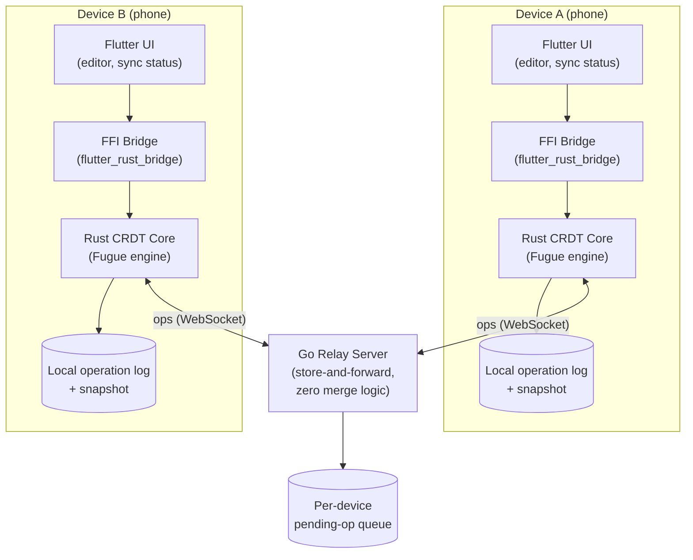
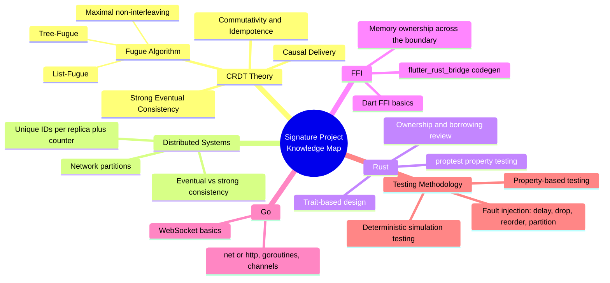
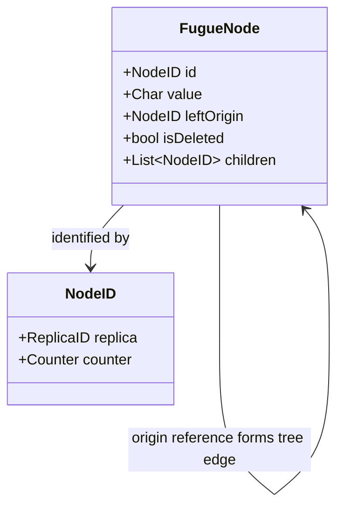
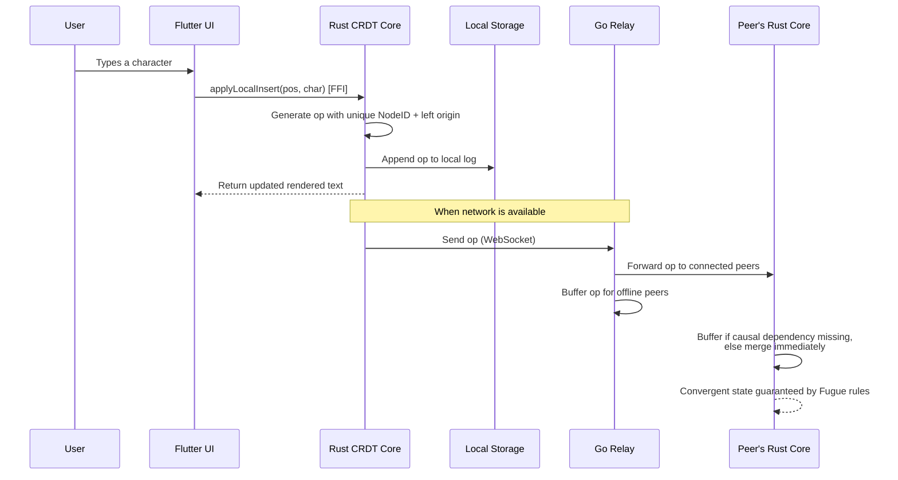
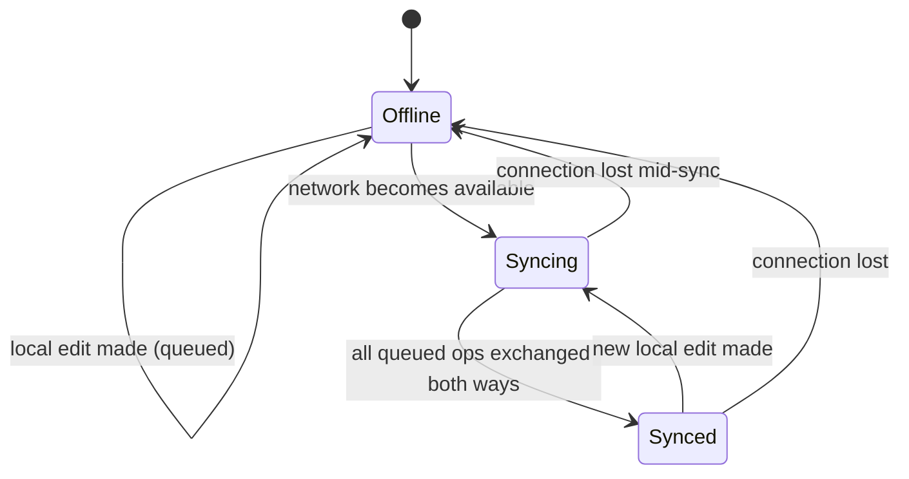
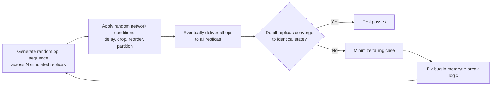
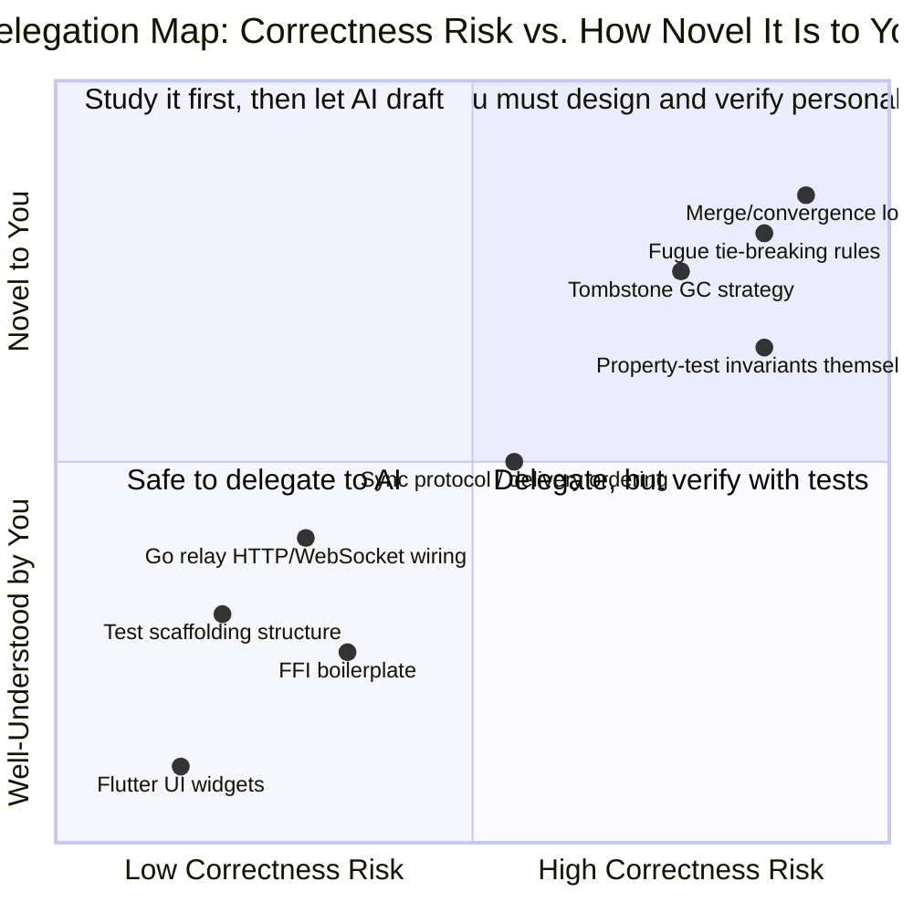
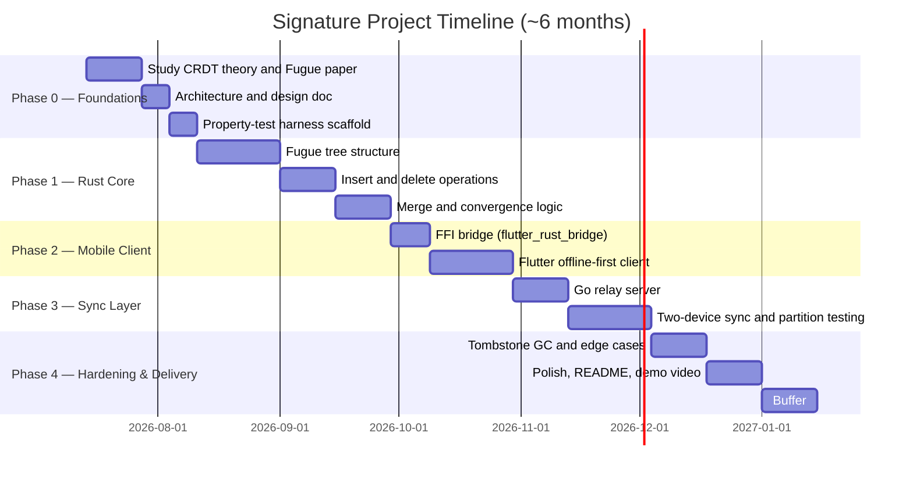

# Project Foundation Document

## Working title: "Loom" — A Hand-Built CRDT Sync Engine (Rust core · Flutter client · Go relay)

| | |
| --- | --- |
| **Owner** | Fady Philip |
| **Status** | Pre-build — foundation for milestone/sprint planning and PRD generation |
| **Timeline** | ~6 months (mid-July 2026 → mid-January 2027, before mandatory military service) |
| **Target outcome** | A signature project that gets employers to call for a mobile/systems engineering interview |
| **Identity this proves** | Mobile & Systems Engineer — offline-first architecture, native performance via Rust FFI, distributed-systems correctness |
| **Doc version** | 1.0 |

---

## How to Use This Document

This is the raw material, not the plan itself. It exists to answer one question completely: **what is this thing, and what do I need to know to build it for real.** You'll take this into your harness to get grilled, and the output of that becomes your PRD. From the PRD you'll cut milestones, and from milestones you'll cut sprints or Kanban cards.

Read it once end to end before generating anything else. Sections 9 and 13 matter most for how you actually work day to day — read them twice.

---

## Table of Contents

1. [Context & Constraints](#1-context--constraints)
2. [The One-Sentence Pitch](#2-the-one-sentence-pitch)
3. [System Architecture](#3-system-architecture)
4. [Core Theory You Need Before Writing Any Code](#4-core-theory-you-need-before-writing-any-code)
5. [The Algorithm: Fugue, In Depth](#5-the-algorithm-fugue-in-depth)
6. [Component Specifications](#6-component-specifications)
7. [Data & Control Flow](#7-data--control-flow)
8. [Where AI Helps vs. Where You Must Own It](#8-where-ai-helps-vs-where-you-must-own-it)
9. [Learning Plan](#9-learning-plan)
10. [Testing & Verification Strategy](#10-testing--verification-strategy)
11. [Milestones & Timeline](#11-milestones--timeline)
12. [Risks & Mitigations](#12-risks--mitigations)
13. [Definition of Done](#13-definition-of-done)
14. [Interview Narrative](#14-interview-narrative)
15. [Glossary](#15-glossary)
16. [Reference Reading List](#16-reference-reading-list)
17. [Open Decisions (resolve before PRD)](#17-open-decisions-resolve-before-prd)

---

## 1. Context & Constraints

- **You:** fresh graduate, bachelor's in CS, Flutter/Dart background with real architectural depth (clean architecture, BLoC, DI lifecycle discipline), self-taught Rust (built `git-rs` from scratch), beginner Go.
- **Clock:** ~6 months of genuinely free time before mandatory military service application in January. This is a hard stop, not a soft estimate.
- **Audience this project is written for:** employers and engineers conducting technical interviews — **not** a graduate-school admissions committee. That choice determines everything below: it's why Flutter stays in scope at all, and why the project ends in something a person can actually pick up and use on two phones, not just a formally verified algorithm on paper.
- **Working method:** you will use an AI coding agent for the majority of code production. You will not hand-write most of it. You will review rigorously, run milestones through Kanban/Scrum-style cards, and are responsible for the correctness of anything you can't personally explain. Section 8 exists specifically to make that split explicit and non-negotiable.
- **Why this project, briefly:** it was chosen after rejecting several strong alternatives — a wrapper around an existing local-LLM runtime (already solved multiple times over on pub.dev), a generic "collaborative notes app" (Yjs/Automerge/Loro/AFFiNE already own that space), a RISC-V emulator and a from-scratch storage engine (both excellent, but they tell an academic/architecture story, not a mobile-engineer one), and a BLoC dev-tool linter (genuinely useful, but a smaller, single-skill signal next to this). This project was picked because it's the one place your existing specialization (offline-first mobile), your systems ambition (git-rs-caliber correctness work), and your practical skillset (Flutter, emerging Rust, some Go) all load-bear on the same artifact.

---

## 2. The One-Sentence Pitch

**A note-taking app where two or more devices can edit the same document while offline, and when they reconnect — in any order, after any amount of time, on any network — they always converge to the exact same content, with your own hand-built CRDT engine underneath, not a library.**

The notes app is the demo surface. The engine is the project.

---

## 3. System Architecture

Three components, three languages, three distinct jobs. None of them do each other's work.

**Why this shape, not one codebase:** the Rust core is the only place correctness lives — it should be testable and reasoned about with zero UI or network noise in the way. The Flutter layer is intentionally "dumb" — it renders state and forwards user intent, nothing more. The Go relay is intentionally dumber still — it does not understand CRDT semantics at all; it just stores and forwards opaque byte blobs per device, which means a bug in the relay can never corrupt a document, only delay its delivery. That containment of blast radius is itself a design decision worth defending in an interview.

---

## 4. Core Theory You Need Before Writing Any Code

You cannot judge AI-generated CRDT code without these concepts living in your head first, not in a doc you look up mid-review.

### The concepts, plainly

| Concept | What it actually means | Why it matters here |
| --- | --- | --- |
| **Strong Eventual Consistency (SEC)** | If two replicas have received the same set of updates (in any order), they must be in the same state. | This is the formal promise your engine has to keep. Everything else is in service of this one guarantee. |
| **Commutativity** | Applying update A then B gives the same result as B then A. | Concurrent edits from two offline devices arrive in unpredictable order — commutativity is what makes that safe. |
| **Idempotence** | Applying the same update twice has the same effect as applying it once. | Networks duplicate messages. Your relay might redeliver. The engine must not care. |
| **Causal delivery** | An update that depends on an earlier one (e.g., "delete character X") must not be applied before the update it depends on (the insertion of X) is known. | Get this wrong and deletes can silently no-op or crash on a missing reference. |
| **Unique IDs (replica ID + counter)** | Every character/operation gets a globally unique ID, not a plain array index. | Array indices shift under concurrent edits and become meaningless the instant two people type at once. |
| **Interleaving anomaly** | Naive list CRDTs can merge two people's concurrently-typed sentences character-by-character into gibberish. | This is the exact, real, published problem Fugue exists to solve — and why "just use RGA" is the wrong shortcut. |

---

## 5. The Algorithm: Fugue, In Depth

**Fugue** (Weidner, Gentle, Kleppmann, 2023) is the CRDT algorithm you will implement. It solves the interleaving problem that older list-CRDTs (RGA, WOOT, Logoot) either ignore or handle badly.

**Core idea:** every inserted character becomes a node in a tree, not a slot in a flat list. Each node remembers its **left origin** (the character it was inserted immediately after) and, in some formulations, enough structural context to resolve concurrent insertions at the same position without scattering them across each other. Deletions don't remove nodes — they mark them as **tombstones**, because a node might still be referenced as another node's origin.

**The property that matters:** the paper defines **maximal non-interleaving** and proves Fugue achieves it — when two users concurrently type at the same position, their text stays intact and contiguous instead of being character-shuffled together. This is the one correctness property you should be able to state from memory and explain with an example in an interview, because it's the actual reason this algorithm exists instead of an older, simpler one.

**Two equivalent formulations exist** (the paper proves this): **Tree-Fugue** (explicit tree structure, easier to reason about first) and **List-Fugue** (flat list with equivalent semantics, better raw performance). Recommendation: implement Tree-Fugue first for correctness and understanding; consider List-Fugue only if you have time left and want the performance story for the interview.

---

## 6. Component Specifications

### 6.1 Rust CRDT Core

**Responsibility:** the entire correctness surface of the project. Nothing else in the system is allowed to make a decision about merge order, tie-breaking, or convergence.

- Data structure: Fugue tree (§5), keyed by `NodeID { replica_id, counter }`
- Operations exposed: `insert(pos, char)`, `delete(node_id)`, `merge(remote_ops)`, `serialize()`, `deserialize()`
- Internal invariant enforcement: every operation must be checked against causal-delivery order before application (buffer ops whose dependencies haven't arrived yet)
- Garbage collection: tombstones accumulate forever unless you implement a causal-stability check (a tombstone can be physically removed once every replica is known to have seen it) — this is one of the hardest parts of the whole project and it is explicitly **your job to design**, not the agent's (see §8)

### 6.2 FFI Bridge

**Responsibility:** move operations and state across the Dart↔Rust boundary without corrupting memory or leaking it.

- Recommended tool: `flutter_rust_bridge` (mature codegen, handles the tedious binding work)
- What crosses the boundary: serialized operations (bytes), not live object graphs
- What must never cross carelessly: raw pointers without a clear ownership story — this is the single most common source of use-after-free / memory leak bugs in Dart↔Rust FFI projects, and AI-generated FFI glue code frequently gets ownership subtly wrong in ways that only surface under load

### 6.3 Flutter Client

**Responsibility:** render state, capture intent, stay thin.

- A basic rich-enough text editor widget (start with plain text, not full rich text — rich text CRDTs, à la Peritext, are a v2 problem, not a v1 one)
- Local persistence of the operation log (so the app works fully offline, including across app restarts)
- A visible sync status indicator (offline / syncing / synced) — small UI, but it's the part that makes the demo legible to a non-technical interviewer in ten seconds
- Explicitly **not** the client's job: any merge logic, any conflict resolution, any decision about operation ordering

### 6.4 Go Relay Server

**Responsibility:** store-and-forward. Nothing smarter than that.

- Accepts a WebSocket connection per device, tagged by a document/room ID
- Forwards incoming operations to all other currently-connected devices for that document
- **Buffers per-device queues for devices that are offline** — this is a small but real persistence requirement; a relay that drops messages for offline devices defeats the entire point of offline-first
- Deliberately does not parse, interpret, or validate CRDT semantics — if it did, a relay bug could corrupt documents, which breaks the whole safety argument of the design
- This is real, if simple, distributed-systems work: message routing, connection lifecycle, basic backpressure — it's the legitimate use of Go here, not a checkbox

---

## 7. Data & Control Flow

### 7.1 A single local edit, end to end

### 7.2 Connection lifecycle (per device)

### 7.3 The correctness test loop (conceptual — see §10 for the real version)

---

## 8. Where AI Helps vs. Where You Must Own It

This is the section you said matters most, so it gets the sharpest framing.

### The actual rule of thumb

> **If you can't explain why an operation is correct without opening the file again, you don't own it yet — and if you don't own it, you can't defend it in an interview or trust it in production.**

**Safe to hand to the agent, review lightly:**

- FFI glue/binding boilerplate (once you understand the ownership model conceptually)
- Flutter widget code, layout, sync-status UI
- Go server scaffolding — routes, connection handling, standard WebSocket plumbing
- Test file scaffolding (the structure, not the invariants)
- README formatting, doc comments

**Must be yours, non-negotiably:**

- The specification of what "correct" means — the invariants themselves (commutativity, idempotence, causal delivery, maximal non-interleaving) must live in your head before a single property test is written, because you are the one deciding what the test is allowed to assert
- The tie-breaking logic in the merge algorithm — this is the actual intellectual content of the project; generating it without understanding it makes the rest of the project a demo of someone else's paper, not evidence of your engineering
- Diagnosing any convergence failure — this requires reasoning about causal history and interleavings, not reading a stack trace; an agent can suggest hypotheses, but you have to be able to evaluate them
- The README's design-decisions section, written in your own words — this is the part of your existing repos (git-rs, Osserva) that already makes them read as real engineering rather than tutorial output; it's the one part no agent can substitute for, because it requires you to actually have understood what got built

---

## 9. Learning Plan

Ordered by dependency — later topics assume earlier ones.

1. **CRDT fundamentals** — read Shapiro et al. (2011) first; it's short and gives you the vocabulary (state-based vs. operation-based CRDTs, semilattices, SEC) everything else assumes.
2. **The interleaving problem** — read Kleppmann et al. (2019) on interleaving anomalies before touching the Fugue paper; you need to see the problem clearly before you can appreciate the fix.
3. **Fugue itself** — Weidner, Gentle, Kleppmann (2023), full read, twice. First pass for the concepts, second pass with a pen, tracing through the worked examples by hand.
4. **Local-first software, the philosophy** — Kleppmann, Wiggins, van Hardenberg, McGranaghan (2019). Not strictly required to implement Fugue, but it's the framing you'll use to explain *why* this class of software matters at all, which is exactly the kind of context that makes an interview answer land.
5. **Rust review** — ownership, borrowing, and trait-based API design specifically as they apply to a tree structure with cross-references (this is where Rust's borrow checker will actively fight you — expect it, budget time for it).
6. **Property-based testing** — the `proptest` crate; learn to write generators for random operation sequences and shrinkers that minimize failing cases.
7. **Dart FFI + flutter_rust_bridge** — the mechanics of the boundary: what serializes cleanly, what doesn't, how errors propagate.
8. **Go basics for the relay** — `net/http`, goroutines and channels, and a WebSocket library; this is a small, bounded amount of Go, not a general Go curriculum.
9. **Deterministic simulation testing** — the pattern used by systems like FoundationDB and TigerBeetle: a single-threaded, seeded scheduler that simulates many "replicas" and network conditions deterministically so failures are 100% reproducible. This is the part most engineers your stage have never been exposed to, and it's a legitimate differentiator to be able to speak to in an interview.

---

## 10. Testing & Verification Strategy

Manual review will not catch concurrent-correctness bugs. Full stop. This is the section that replaces "read the diff carefully" with something that actually works.

**Layer 1 — Unit tests.** Standard, per-operation correctness. AI can draft these; you verify they test the right things.

**Layer 2 — Property-based tests (`proptest`).** Generate random sequences of inserts/deletes across simulated replicas in random orders; assert every replica converges to an identical final document regardless of delivery order. You write the properties being asserted. The agent can help generate the test harness scaffolding.

**Layer 3 — Deterministic simulation testing.** A seeded, single-threaded simulator that can inject network delay, message drop, duplication, reordering, and full partitions, then verify convergence once messages are eventually delivered. This is the most valuable and most difficult testing work in the entire project — it is also the closest thing to a second signature skill this project can produce, alongside the CRDT itself.

**Layer 4 — Manual cross-device testing.** Two real phones, airplane mode, edit both, reconnect, watch it converge. This is what goes in the demo video, and it's also a legitimate final sanity check that Layers 1–3 didn't miss something environmental (real network stacks, real OS backgrounding behavior).

---

## 11. Milestones & Timeline

### Milestone exit criteria (for Kanban/sprint breakdown)

| Milestone | Exit criteria |
| --- | --- |
| Phase 0 | You can explain the interleaving problem and Fugue's fix from memory, unaided. Test harness skeleton exists and runs (even against a stub implementation). |
| Phase 1 | Rust core passes property tests for convergence under randomized single-replica operation reordering. |
| Phase 2 | A single device can type, persist, and restart the app without data loss. |
| Phase 3 | Two physical devices, disconnected and reconnected in arbitrary order, always converge. Partition test suite passes. |
| Phase 4 | Tombstones are garbage-collected without breaking causal history. README explains every major design decision. Demo video exists. |

---

## 12. Risks & Mitigations

| Risk | Why it's real | Mitigation |
| --- | --- | --- |
| Tombstone GC is genuinely hard | Removing a tombstone too early can break another node's origin reference | Implement GC last, after the core is proven correct without it; treat unbounded tombstone growth as an acceptable v1 limitation if time runs short |
| FFI memory bugs | Dart↔Rust ownership mistakes cause crashes that look unrelated to the actual bug | Keep the FFI surface as narrow as possible (pass serialized bytes, not object graphs); write FFI-boundary tests early |
| Scope creep into rich text | Peritext-style rich-text CRDTs are a much larger problem than plain text | Explicitly scope v1 to plain text; document rich text as a stated "not doing this" in the README |
| AI-generated correctness bugs that look right | Convergence bugs often only appear under specific interleavings, not in the happy path | Property-based + simulation testing (§10) is the actual defense, not code review — treat this as load-bearing infrastructure, build it early, not last |
| Timeline pressure against the January deadline | Six months is real but not elastic | Phase 4 has an explicit 14-day buffer; if behind, cut GC and rich-text scope before cutting testing or the README |
| You lose the thread of "why" mid-project | Long systems projects can turn into just making tests pass | Re-read §14 (Interview Narrative) monthly — it's the thing that keeps the project pointed at its actual purpose |

---

## 13. Definition of Done

- [ ] Two physical devices sync a shared document correctly after arbitrary offline periods, in either order of reconnection
- [ ] Property-based tests pass for convergence under randomized operation interleaving (hundreds of generated cases minimum)
- [ ] Deterministic simulation tests pass under injected delay, duplication, reordering, and partition
- [ ] No interleaving anomalies observable when two devices type concurrently at the same position
- [ ] Tombstones are collected without corrupting document history (or the limitation is explicitly documented as a known v1 gap)
- [ ] README documents the engineering decisions — same bar as your existing repos — not just usage instructions
- [ ] A short demo video exists showing the offline/reconnect/converge flow on real devices
- [ ] You can explain, unaided and from memory, why the algorithm is correct — this is the real finish line, not the code

---

## 14. Interview Narrative

**What this project actually proves:** you can take a real, published, unsolved-until-recently distributed-systems problem, implement the solution correctly enough to pass property-based and simulation tests, and ship it across a real mobile app with a real sync layer — while directing an AI agent through the parts that don't require deep understanding and personally owning the parts that do.

**Sample questions to have a real answer for:**

- "Walk me through what happens when two devices edit the same position in a document while offline, then reconnect." — trace the origin-based tie-breaking, not just "it merges."
- "What happens if your relay redelivers the same operation twice?" — idempotence, and why the operation's unique ID makes this safe.
- "How do you know your merge logic is actually correct, not just correct on the cases you tried?" — property-based and simulation testing, not "I tested it manually."
- "Why Fugue and not a simpler CRDT?" — the interleaving anomaly, with a concrete example.
- "Why is the relay in Go and not just another Rust or Dart service?" — the deliberate simplicity argument: a dumb relay can't corrupt data even if it has bugs.

---

## 15. Glossary

- **CRDT (Conflict-free Replicated Data Type):** a data structure designed so that concurrent, independent updates always merge without conflicts, converging to the same state everywhere.
- **Strong Eventual Consistency (SEC):** the guarantee that replicas which have seen the same updates (regardless of order) are in identical states.
- **Commutativity:** operation order doesn't affect the result.
- **Idempotence:** applying an operation more than once has the same effect as applying it once.
- **Causal delivery:** an operation isn't applied until everything it depends on has already been applied.
- **Tombstone:** a deleted element that's kept (marked, not removed) because something else may still reference it.
- **Interleaving anomaly:** the bug where two people's concurrently-typed text gets merged character-by-character into a scrambled result.
- **Tree-Fugue / List-Fugue:** the two equivalent internal representations of the Fugue algorithm.
- **FFI (Foreign Function Interface):** the mechanism letting Dart code call into compiled Rust code directly.
- **Deterministic simulation testing:** running a system under a controlled, seeded scheduler so that failures are perfectly reproducible, used to test distributed correctness without real network flakiness.

---

## 16. Reference Reading List

1. Shapiro, M., Preguiça, N., Baquero, C., Zawirski, M. *Conflict-free Replicated Data Types.* SSS 2011.
2. Kleppmann, M., Gomes, V. B. F., Mulligan, D. P., Beresford, A. R. *Interleaving anomalies in collaborative text editors.* PODC 2019.
3. Weidner, M., Gentle, J., Kleppmann, M. *The Art of the Fugue: Minimizing Interleaving in Collaborative Text Editing.* arXiv:2305.00583, 2023.
4. Kleppmann, M., Wiggins, A., van Hardenberg, P., McGranaghan, M. *Local-first software: you own your data, in spite of the cloud.* Onward! 2019.

---

## 17. Open Decisions (resolve before PRD)

These are recommended defaults, not final calls — surface them explicitly in the harness/PRD step rather than letting them stay implicit.

- **Persistence format for the local operation log:** recommended default is an append-only log + periodic snapshot compaction (simpler to implement correctly than embedding a full SQL store); confirm or override.
- **WebSocket library for the Go relay:** confirm a specific library choice (e.g., `nhooyr.io/websocket` or `gorilla/websocket`) before Phase 3 starts.
- **Rich text scope:** confirmed out of scope for v1 (plain text only) — revisit only if all Phase 4 exit criteria are met early.
- **List-Fugue as a stretch goal:** worth attempting only if Phase 1–3 finish ahead of schedule; not part of the core Definition of Done.
- **Encryption/end-to-end privacy of synced content:** out of scope for v1; note as a stated future-work item in the README rather than silently ignoring it.
